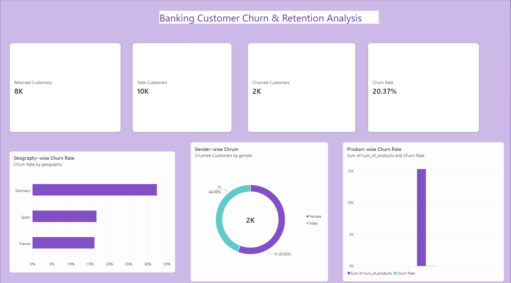

Banking Customer Churn & Retention Analysis

Project Overview

This project analyzes banking customer data to identify customer churn patterns and understand the factors influencing customer retention. The goal is to help banks improve customer satisfaction and reduce customer loss through data-driven insights.

Dataset

- Dataset: Bank Customer Churn Modeling
- Total Records: 10,000
- Target Variable: Exited
- Churned Customers: 2,037
- Retained Customers: 7,963

Tools & Technologies

- Python
- Pandas
- NumPy
- Matplotlib
- Seaborn
- PostgreSQL
- Power BI

Project Workflow

1. Python – Exploratory Data Analysis

- Data loading and cleaning
- Missing value and duplicate checking
- Customer churn distribution analysis
- Gender-wise and geography-wise analysis
- Age group and customer activity analysis
- Correlation analysis

2. PostgreSQL – SQL Analysis

- Created customer table
- Imported 10,000 customer records
- Analyzed overall churn rate
- Performed geography-wise and gender-wise analysis
- Analyzed customer activity, age and product usage

3. Power BI – Dashboard

Created an interactive dashboard containing:

- Total Customers
- Churned Customers
- Retained Customers
- Churn Rate
- Geography-wise Churn
- Gender-wise Churn
- Products-wise Churn

## Power BI Dashboard

Key Business Insights

- Total customers: 10,000
- Churned customers: 2,037 (20.37%)
- Retained customers: 7,963 (79.63%)
- Germany showed a comparatively higher churn rate.
- Inactive members showed higher churn.
- Customer age and product usage are useful factors for understanding churn patterns.

Conclusion

This project demonstrates how Python, PostgreSQL and Power BI can be used together to analyze banking customer behavior, identify churn patterns and support better customer retention strategies.

Author

Vishva Modi

Final Year B.E. Information Technology Student